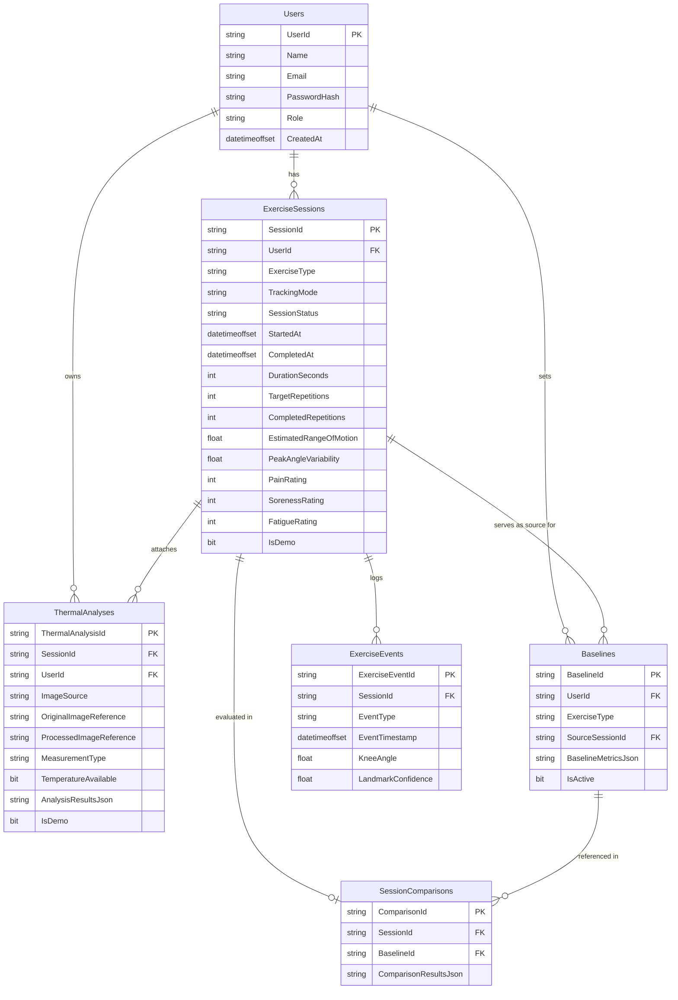

# TheraTrack System Architecture & Technical Specifications

## 1. System Overview

TheraTrack is a functional rehabilitation monitoring prototype designed for tracking exercise repetitions, joint kinematics (knee extension angle & range of motion), thermal image intensity statistics, and mathematical progression against an individual's baseline.

```
+-------------------------------------------------------------------------+
|                              React Frontend                             |
|         Vite + TypeScript + Tailwind CSS + Recharts + Lucide UI         |
|  (Webcam Pose Estimation, Live Canvas Overlay, Manual Telemetry)        |
+------------------------------------+------------------------------------+
                                     | HTTP / REST (Port 5173 -> 5000)
                                     v
+-------------------------------------------------------------------------+
|                          Node.js Express Backend                        |
|   (Authentication, JWT HttpOnly Cookies, MSSQL Parameterized Queries,   |
|         Business Logic, Baseline Comparisons, Report Generation)        |
+-------------------+--------------------------------+--------------------+
                    |                                |
     Port 1433      |                                | HTTP Multipart
     (mssql pool)   |                                | Port 8001
                    v                                v
+-----------------------+        +----------------------------------------+
| Microsoft SQL Server  |        |      Python Thermal Analysis Service   |
|   (TheraTrackDb)      |        |        (FastAPI + OpenCV + NumPy)      |
|  - Users              |        |  - Validation & Colormapping (INFERNO) |
|  - ExerciseSessions   |        |  - Dual Rectangular ROI Statistics     |
|  - ThermalAnalyses    |        |  - Bilateral Regional Asymmetry        |
|  - Baselines          |        |  - Pre/Post Exertion Thermal Comparison|
|  - SessionComparisons |        +----------------------------------------+
|  - ExerciseEvents     |
+-----------------------+
```

---

## 2. Request and Data Flow

### A. Authentication & Session Initiation
1. Patient logs in or registers via `/api/auth/login` or `/api/auth/register`.
2. Node.js hashes passwords with `bcryptjs` (salt rounds 10) and verifies against the `Users` table in MSSQL.
3. Node.js issues a secure signed JWT in an HttpOnly cookie or Bearer token header.
4. Patient configures exercise targets (e.g. 10 reps of seated knee extensions) and pre-session discomfort ratings (pain, soreness, fatigue 0–10).

### B. Exercise Repetition Tracking (Module B)
1. Browser prompts for webcam permission (`navigator.mediaDevices.getUserMedia`).
2. Browser performs vector geometric angle estimation on hip, knee, and ankle coordinates:
   $$\theta = \arccos\left(\frac{\vec{v}_{knee \to hip} \cdot \vec{v}_{knee \to ankle}}{\|\vec{v}_{knee \to hip}\| \|\vec{v}_{knee \to ankle}\|}\right) \times \frac{180}{\pi}$$
3. Finite-State Machine (FSM):
   - `FLEXED` ($\le 95^\circ$)
   - `EXTENDING` ($> 100^\circ$)
   - `EXTENDED` ($\ge 150^\circ$)
   - `RETURNING` ($< 145^\circ$ returning to $\le 105^\circ$)
4. A repetition increments **only** upon returning to flexion after having reached extension.
5. In manual fallback mode, patient clicks manual increment buttons with a designated angle slider; metrics are recorded and tagged as `"manual"`.
6. Repetition milestones are dispatched to `POST /api/sessions/:id/events` and finalized via `POST /api/sessions/:id/finish`.

### C. Thermal Image Processing (Module A)
1. User uploads a thermal image or chooses a bundled demonstration image (`sample_knees_resting.png`, `sample_knees_post_exercise.png`).
2. Node.js forwards the image to the Python FastAPI microservice via multipart form-data.
3. Python decodes the matrix using OpenCV, applies display window clipping, Gaussian noise reduction, and the selected colormap (e.g., `INFERNO`, `TURBO`, `JET`).
4. Python calculates pixel intensity statistics for Left ROI and Right ROI:
   - Mean, Median, Min, Max, Standard Deviation
   - 16-bin intensity histogram
   - % of pixels exceeding relative intensity threshold ($max \times threshold\%$)
5. Python calculates bilateral regional difference:
   $$\Delta_{intensity} = |Mean_{Left} - Mean_{Right}|$$
6. Mandatory disclaimer is embedded: `"Temperature unavailable — image-intensity analysis only."`
7. Results are persisted to the `ThermalAnalyses` table in MSSQL.

### D. Baseline Establishment & Comparison (Module C)
1. User selects any completed session as their active baseline for an exercise type.
2. For subsequent sessions, mathematical comparisons are computed:
   $$Absolute\ Difference = Value_{current} - Value_{baseline}$$
   $$Percentage\ Change = \frac{Value_{current} - Value_{baseline}}{Value_{baseline}} \times 100$$
3. Factual comparison statements are generated without inferring clinical diagnoses.

---

## 3. Database Entity Relationship Diagram (ERD)



---

## 4. API Endpoint Reference

| Method | Endpoint | Description | Auth Required |
|---|---|---|---|
| POST | `/api/auth/register` | Register new patient account | No |
| POST | `/api/auth/login` | Authenticate and issue JWT | No |
| POST | `/api/auth/logout` | Clear session cookie | No |
| GET | `/api/auth/me` | Fetch authenticated patient profile | Yes |
| GET | `/api/health` | Comprehensive diagnostic check (MSSQL + Python) | No |
| GET | `/api/thermal/samples` | List bundled sample demonstration images | No |
| POST | `/api/thermal/analyze` | Process image via OpenCV & calculate ROI stats | Optional |
| POST | `/api/thermal/compare` | Pre- vs Post-exercise thermal delta analysis | Optional |
| POST | `/api/sessions` | Initialize new exercise session | Yes |
| GET | `/api/sessions` | List sessions for current user | Yes |
| GET | `/api/sessions/:id` | Session details, thermal links & events | Yes |
| POST | `/api/sessions/:id/events` | Record repetition or phase transition event | Yes |
| POST | `/api/sessions/:id/finish` | Finalize session and persist summary metrics | Yes |
| DELETE | `/api/sessions/:id` | Delete user session | Yes |
| POST | `/api/baselines` | Designate a completed session as reference baseline | Yes |
| GET | `/api/baselines` | List patient baselines | Yes |
| POST | `/api/sessions/:id/compare` | Evaluate session progression against baseline | Yes |
| GET | `/api/dashboard/summary` | Aggregate dashboard summary cards | Yes |
| GET | `/api/dashboard/progress` | Timeseries progress data for Recharts | Yes |
| GET | `/api/sessions/:id/export` | Export session report as CSV or JSON | Yes |
| POST | `/api/demo/seed` | Inject 3 progressive demo sessions & comparisons | Yes |
| POST | `/api/demo/clear` | Safely remove demonstration records (`IsDemo=1`) | Yes |
| GET | `/api/images/:folder/:file`| Secure static image streaming (path traversal protected)| No |

---

## 5. Feature-to-Source-File Mapping

| Functional Requirement | Primary Source Files |
|---|---|
| **MSSQL Database Schema & Connection** | `database/schema.sql`, `backend/src/config/db.ts` |
| **Authentication & Authorization** | `backend/src/routes/auth.routes.ts`, `backend/src/middleware/auth.ts`, `frontend/src/context/AuthContext.tsx` |
| **Python Thermal Image Processing** | `analysis-service/src/processor.py`, `analysis-service/src/main.py`, `analysis-service/src/models.py` |
| **Demonstration Thermal Samples** | `analysis-service/src/sample_generator.py`, `data/samples/` |
| **Node.js Python HTTP Client** | `backend/src/services/analysisClient.ts` |
| **Exercise Tracking & Angle FSM** | `frontend/src/pages/ExerciseTracking.tsx`, `backend/src/routes/session.routes.ts` |
| **Baseline Comparisons & Math** | `backend/src/routes/baseline.routes.ts`, `frontend/src/pages/BaselineProgress.tsx` |
| **Dashboard & Recharts Telemetry** | `frontend/src/pages/Dashboard.tsx`, `backend/src/routes/dashboard.routes.ts` |
| **Session History & CSV/JSON Export**| `frontend/src/pages/SessionHistory.tsx`, `frontend/src/pages/SessionDetails.tsx`, `backend/src/routes/export.routes.ts` |
| **Demo Mode Seeding & Clearing** | `backend/src/routes/demo.routes.ts`, `frontend/src/pages/Settings.tsx` |
| **Medical Safety Disclaimers** | `frontend/src/components/MedicalDisclaimer.tsx` |
